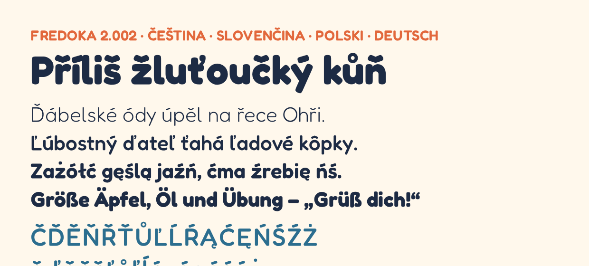

# Fredoka One


Fredoka One is a big, round, bold font that is perfect for adding a little fun to any headline or large text.

The initial Latin component was designed by <a href="mailto:milenabbrandao@gmail.com">Milena Brandão</a>.
The later Hebrew component was designed by Ben Nathan.

The Fredoka project is led by Ben Nathan, a typeer design foundry based in Israel. 
To contribute, see <a href="https://github.com/hafontia/Fredoka-One">github.com/hafontia/Fredoka-One</a>

## Czech, Slovak and Polish (version 2.002)



Fredoka 2.001 lacks most Central European letters, so browsers fall back to another font in the middle of Czech, Slovak or Polish words. Version 2.002 of this fork adds them in all weights and widths:

| Language | Added letters |
| --- | --- |
| Czech | Č č Ď ď Ě ě Ň ň Ř ř Ť ť Ů ů |
| Slovak | Ľ ľ Ĺ ĺ Ŕ ŕ (with Ď ď Ť ť) |
| Polish | Ą ą Ć ć Ę ę Ń ń Ś ś Ź ź Ż ż |

German already worked in 2.001 (ä ö ü ß Ä Ö Ü „ “). The capital ẞ is not included; German capitalizes ß as SS.

The letters are built from the font's own bases and accents, following the anchors of the source (the same rule as the existing á, š or å). Ď ť ľ Ľ use a vertical caron drawn from the font's comma. Everything that worked in 2.001 is unchanged: the same outlines, advances and kerning for every existing character. New letters kern the way the font already kerns its accented letters.

### Building

```sh
uv venv .venv --python 3.12
uv pip install --python .venv/bin/python -r scripts/requirements.txt
.venv/bin/python scripts/add_central_european.py   # adds the letters to sources/Fredoka.glyphs
.venv/bin/python scripts/build_release.py          # writes fonts/ and verifies the result
```

`build_release.py` adds the new glyphs to the mastered 2.001 binary (`sources/base/`) instead of recompiling every glyph. Current font tools build the 2.001 source with different kerning than the published font, so a full rebuild would change the spacing of text that already worked. The script checks that every existing glyph and every pair of existing characters shapes exactly as in 2.001, at nine weight and width combinations. It also checks that each new letter kerns like its base letter.

## License

This Font Software is licensed under the SIL Open Font License, Version 1.1 (see [OFL.txt](OFL.txt)).
